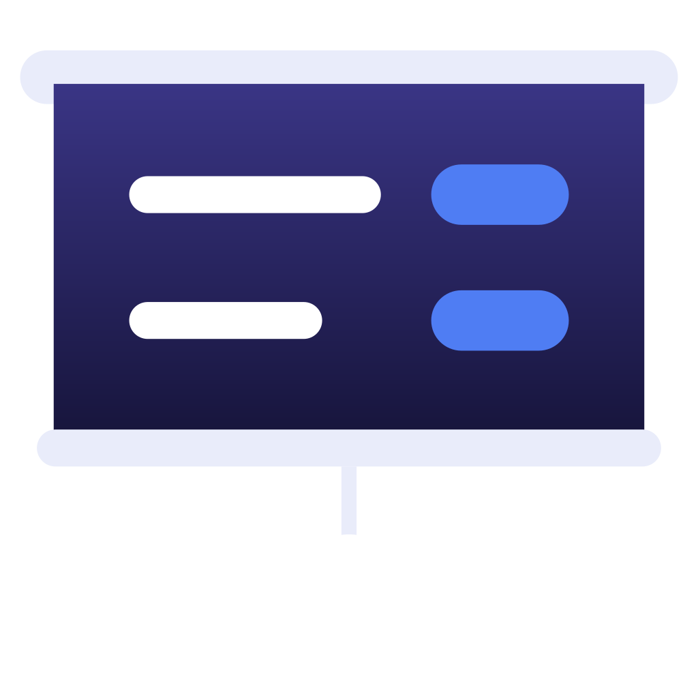
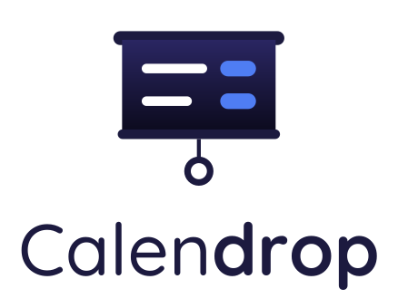
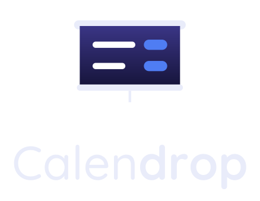
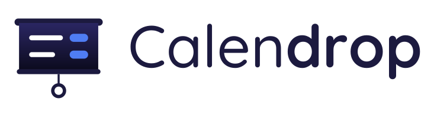

# calendrop-brand

The Calendrop logo and the rules for using it.

The Calendrop name and logo are **not** under an open source license. How you may use them is set out in the [Calendrop Trademark Policy](TRADEMARKS.md); in short, you may use them to refer to Calendrop itself, but not to name or brand anything else. This README describes the logo and how to display it.

## Logo

The logo is a symbol — a roller blind pulled down, with the next meetings on its cloth — and the wordmark "Calendrop". The SVG files in `logo/` are the originals. `png/` has each of them rendered at several sizes with a transparent background, named `<name>-<width>x<height>.png`; `scripts/png.sh` makes them from the SVGs.

### Meaning

- Roller blind: Calendrop drops a cut-in over every screen before a meeting, the way a blind comes down over a window.
- Meetings on the cloth: what the blind shows is the meeting itself — its title and the button that joins it.
- Cord and ring: the blind stays down until it is pulled; the cut-in stays until the user joins or deliberately dismisses it.

The wordmark sets "Calen" lighter than "drop" to show that the name is made of two words: the calendar, and the drop of the cut-in.

### Variants

| Variant          | Light | Dark | Mono black | Mono white | Use |
| ---------------- | ----- | ---- | ---------- | ---------- | --- |
| Symbol (regular) |  |  |  |  | Icons at 32px and above |
| Symbol (small)   |  |  |  |  | Menu bar, icons at 24px and below |
| Vertical logo    |  |  | — | — | Covers, README headers |
| Horizontal logo  |  |  | — | — | Headers, banners |

### Colors

| Element                       | Light             | Dark              |
| ----------------------------- | ----------------- | ----------------- |
| Roller bar, rail, cord, ring  | #1C1A3F           | #E9ECFA (ring #FFFFFF) |
| Cloth (top → bottom)          | #2A2662 → #0B0A1C | #3A3585 → #16143A |
| Meeting titles                | #FFFFFF           | #FFFFFF           |
| Join button                   | #4F7DF3           | #4F7DF3           |
| Wordmark                      | #1C1A3F           | #E9ECFA           |

### Typeface

The wordmark is set in [Quicksand](https://github.com/google/fonts/tree/main/ofl/quicksand): "Calen" in Medium, "drop" in Bold. Quicksand is under the SIL Open Font License 1.1 and may be used for logo lettering. The text in the SVGs is outlined, so it renders the same where the typeface is not installed.

## Rules for display

These rules apply on top of the [Calendrop Trademark Policy](TRADEMARKS.md), which says when you may use the logo at all.

- At 24px and below, use the small symbol. The meeting rows and the cord of the regular one blur at small sizes.
- Where monochrome icons are the convention, such as a menu bar, use a mono variant.
- Do not stretch or squash it; keep the aspect ratio.
- Do not recolor it with colors not listed here.
- Do not change the placement or proportions of the symbol and the wordmark.
